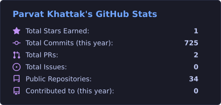
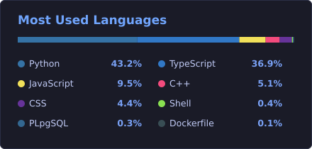

<div align="center">


<p>
  <a href="https://www.linkedin.com/in/parvat-khattak-51a698195"></a>
  <a href="mailto:parvatkhattak03@gmail.com"></a>
  <a href="https://codeforces.com/profile/DarkWeB10"></a>
  <a href="https://github.com/parvatkhattak?tab=repositories"></a>
</p>


</div>

##  System Profile

I'm an **Electrical Engineering graduate from IIT Palakkad** whose path has run from **embedded systems** to **software engineering**, **Generative AI**, a **founding-engineer** role at a startup, and now **Data Science at Tredence**.

I like the whole lifecycle: modeling the problem, shipping the API, and making sure it works in production.

```python
class Parvat:
    role       = "Data Scientist @ Tredence"
    previously = ["Founding Engineer @ Snello.co", "SDE @ Rehumus", "GenAI Dev @ Brix AI"]
    education  = "B.Tech Electrical Engineering, IIT Palakkad (2022–2026)"
    focus      = ["Generative AI", "Agentic AI", "Machine Learning", "System Design"]
    currently  = "Building ML & GenAI solutions for enterprise business problems"
    fun_fact   = "Enjoys competitive programming as much as shipping real products"
```


##  Experience

| Status | Organization | Role | Period |
|:-:|---|---|---|
|  | **Tredence** | Data Scientist | Jun 2026 – Present |
|  | **Snello.co** | SDE Intern → **Founding Engineer** | Jul 2025 – Jun 2026 |
|  | **Rehumus Technology** | Project Intern → Software Development Intern | Sep 2025 – May 2026 |
|  | **Brix AI** | Generative AI Developer Intern | May – Jul 2025 |
|  | **ESSENCE, IIT Palakkad** | AI/ML Research Intern | May – Jul 2025 |
|  | **IPTIF, IIT Palakkad** | Project Intern | May – Jul 2024 |


##  Featured Systems & Projects

<table>
<tr>
<td width="50%" valign="top">

###  [Medical Coding Assistant](https://github.com/parvatkhattak/Medical-Coding-Assistant)
RAG system for ICD-10 coding that retrieves from the guidelines, index, and tabular list. It handles context-aware follow-up questions and shows its reasoning in a debug view.

`FastAPI` `Gemini` `Qdrant` `RAG` `Streamlit`

</td>
<td width="50%" valign="top">

###  [Retail AI — Sales Forecasting](https://github.com/parvatkhattak/AI-Powered-Retail-Sales-Forecasting-Decision-Intelligence)
Decision-intelligence platform: LightGBM/XGBoost forecasting with a LangGraph agent that answers in natural language. Includes observability and FinOps monitoring, and has 288 passing tests.

`LightGBM` `XGBoost` `LangGraph` `Docker`

</td>
</tr>
<tr>
<td width="50%" valign="top">

###  [Periyar Species Extraction](https://github.com/parvatkhattak/Periyar-Species-Data-Extraction-System)
Multimodal pipeline that pulls structured biodiversity data out of ecological documents in batch.

`Gemini 2.0` `OCR` `NLP` `Streamlit`

</td>
<td width="50%" valign="top">

###  [Faceometry](https://github.com/parvatkhattak/Faceometry)
Full-stack facial-geometry analysis. It detects dense 3D landmarks, rectifies head tilt, and scores symmetry and classical proportions.

`MediaPipe` `Computer Vision` `Python`

</td>
</tr>
<tr>
<td width="50%" valign="top">

###  [Super Mario Bros — DDQN](https://github.com/parvatkhattak/Super-Mario-Bros---Reinforcement-learning)
Double Deep Q-Network agent with experience replay. It reduces Q-value overestimation and makes training more stable.

`PyTorch` `Reinforcement Learning` `Gym`

</td>
<td width="50%" valign="top">

###  [Agentic Chatbot — Gemini + LangGraph](https://github.com/parvatkhattak/Agentic-Chatbot-with-Gemini-API-LangGraph)
Agent with intent detection, tool calling, and persistent memory for multiple users.

`LangGraph` `Gemini` `SQLite` `AI Agents`

</td>
</tr>
</table>

<details>
<summary><b><code>[+]</code> Expand additional repositories &amp; engineering work</b></summary>
<br/>

| Project | What it does | Stack |
|---|---|---|
| **LLM-powered Ad Automation** *(Snello.co)* | Agentic campaign orchestration across Google Ads & Meta Ads APIs | LangGraph, LangChain, FastAPI |
| [**Onebox Email Aggregator**](https://github.com/parvatkhattak/onebox-email-aggregator) | Real-time IMAP sync, Gemini categorization & smart replies | TypeScript, Node.js, Elasticsearch |
| [**Promotion Cannibalization & TrueLift**](https://github.com/parvatkhattak/Promotion-Cannibalization) | Separates true incremental lift from cannibalization in CPG promotions | React, Vite, Analytics |
| [**3D Drone Path Planning**](https://github.com/parvatkhattak/3D-Drone-Path-Planning-with-Obstacle-Avoidance) | Interactive 3D path planning with obstacle avoidance — [live demo](https://3-d-drone-path-planning-with-obstac.vercel.app/) | TypeScript, Three.js |
| [**Smart Animal Intrusion — Image**](https://github.com/parvatkhattak/Animal-intrusion-detection--image) · [**Sound**](https://github.com/parvatkhattak/Animal-intrusion-detection--sound) | IoT system with CNN image/audio classification and GSM alerts | CNN, IoT, GSM |
| [**Sound-Based Pet Recognition**](https://github.com/parvatkhattak/Sound-Based-Pet-Animal-Recognition-System) | 2D-CNN on Mel spectrograms for cat/dog sound classification | TensorFlow, Librosa |
| [**Docbot for Aphasia Patients**](https://github.com/parvatkhattak/Docbot-for-Aphasia-Patients) | Personalized, accessible chatbot for people with aphasia | Python, Streamlit |
| [**PSoC 5LP**](https://github.com/parvatkhattak/PSOC-5LP-) | Embedded C firmware, sensor integration & telemetry | C, PSoC |
| **DAYCENT Decision System** *(ESSENCE)* | Python GUI for the DAYCENT model with Earth Engine geospatial analysis | Python, Google Earth Engine |

</details>


##  Tech Stack & Architecture

<table>
<tr><td><b>Languages</b></td><td>

</td></tr>
<tr><td><b>AI / ML</b></td><td>
<br/>


</td></tr>
<tr><td><b>Backend</b></td><td>

</td></tr>
<tr><td><b>Cloud & DevOps</b></td><td>

</td></tr>
<tr><td><b>Databases</b></td><td>
<br/>


</td></tr>
<tr><td><b>Hardware & More</b></td><td>
<br/>


</td></tr>
</table>


##  Achievements & Benchmarks

| | |
|---|---|
| `CF::1500+` **Codeforces** — [DarkWeB10](https://codeforces.com/profile/DarkWeB10) (max 1527) | `DSA::250+` Algorithmic problems solved across platforms |
| `AIR::2487` **IIT-JEE Advanced** | `AIR::2581` **IIT-JEE Main** |
| `INTER-IIT` Represented **IIT Palakkad** at Cultural Meets (Dance & Filmmaking) | `0 -> 1` **Founding Engineer** at an early-stage AI startup |


##  Telemetry & GitHub Activity

<div align="center">
  
  
</div>

<div align="center">
<picture>
  <source media="(prefers-color-scheme: dark)" srcset="https://raw.githubusercontent.com/parvatkhattak/parvatkhattak/output/github-snake-dark.svg" />
  <source media="(prefers-color-scheme: light)" srcset="https://raw.githubusercontent.com/parvatkhattak/parvatkhattak/output/github-snake.svg" />
  
</picture>
</div>


##  Connect

Always happy to talk with engineers, researchers, and founders building in **Generative AI**, **data science**, or **distributed systems**.

<div align="center">

<a href="https://www.linkedin.com/in/parvat-khattak-51a698195"></a>
<a href="mailto:parvatkhattak03@gmail.com"></a>

<br/>

<code>parvatkhattak03@gmail.com</code>

<br/>

<i>"Building things, breaking things, learning things — one commit at a time."</i>

<br/><br/>


</div>
